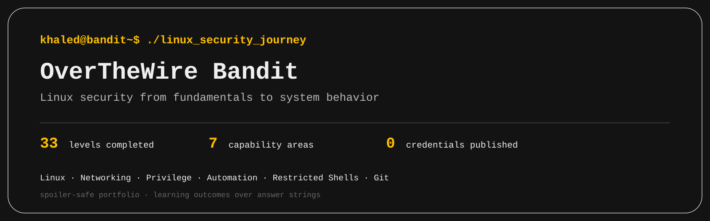
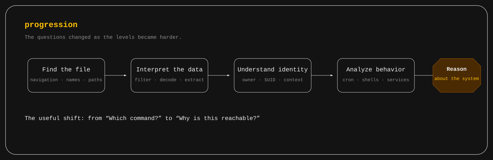
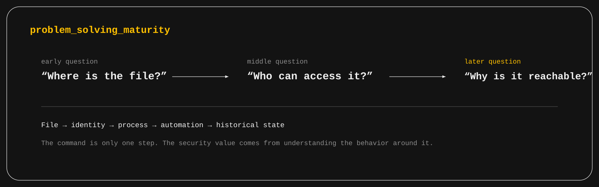

<div align="center">



</div>

---

## What this project is

This repository documents my progression through **OverTheWire Bandit**, a hands-on wargame focused on Unix/Linux fundamentals and security-oriented problem solving.

I completed the progression through **Level 33** and kept notes on the techniques, commands, mistakes, and concepts I learned along the way.

This repository is intentionally **spoiler-safe**.

It does not publish Bandit passwords or reproduce challenge answers. Instead, it translates the work into the capabilities that matter outside the game:

```text
Linux fundamentals
        ↓
File & data analysis
        ↓
Networking & secure access
        ↓
Permissions & privilege
        ↓
Automation & scheduled tasks
        ↓
Restricted environments
        ↓
Git history & repository behavior
```

Official game: [OverTheWire Bandit](https://overthewire.org/wargames/bandit/)

---

## For a non-technical reader

Bandit is not about memorizing commands.

It presents progressively harder Linux problems where the next step is hidden behind file permissions, unusual filenames, encoded data, network services, scheduled tasks, privilege boundaries, shell restrictions, or Git history.

The value of the exercise is the progression:

| Early stages | Later stages |
|---|---|
| Navigate Linux confidently | Investigate how a system behaves |
| Find and inspect files | Understand privilege boundaries |
| Filter and transform data | Analyze scheduled execution |
| Use SSH | Work around restricted environments |
| Read files and permissions | Inspect Git history, branches, tags, and hooks |

The result is practical Linux fluency built through repeated problem solving rather than a command checklist.

<div align="center">



</div>

---

## For a technical reader

The work covered concepts across several Linux and security domains.

<div align="center">


</div>

### Areas practiced

| Area | Examples of concepts practiced |
|---|---|
| **Linux fundamentals** | Files, directories, hidden files, unusual filenames, permissions, shell behavior |
| **Data analysis** | `grep`, `sort`, `uniq`, `strings`, encoding, binary inspection, decompression |
| **Networking** | SSH, local TCP services, TLS connections, service discovery, Netcat |
| **Privilege concepts** | SUID, effective user context, file ownership, protected resources |
| **Automation** | Cron jobs, script execution, temporary files, predictable behavior |
| **Restricted environments** | Shell startup behavior, pagers/editors, alternate shells, command execution context |
| **Git security** | Commit history, removed secrets, branches, tags, ignore rules, server-side hooks |

---

# Learning Path

The original notes were level-by-level.  
This public version reorganizes them into **security capabilities** so the learning is easier to understand and revisit.

## 01 · [Linux Foundations](notes/01-linux-foundations.md)

The first stage was about becoming comfortable with the Linux command line:

- navigating directories;
- understanding hidden files;
- handling filenames that look like command options;
- reading file permissions;
- using commands safely with unusual input.

**Why it matters:**  
Security work becomes much faster when Linux navigation and file handling are automatic rather than something you have to stop and think about.

---

## 02 · [Data & File Analysis](notes/02-data-and-files.md)

The next stage focused on extracting useful information from messy or unfamiliar data.

Topics included:

- searching large files;
- finding unique lines;
- identifying human-readable content;
- decoding and transforming data;
- identifying file types;
- working through multiple compression formats.

**Why it matters:**  
Logs, artifacts, captures, and suspicious files rarely arrive in a clean format. The ability to inspect and transform data is part of everyday security analysis.

---

## 03 · [Networking & Secure Access](notes/03-networking-and-secure-access.md)

This stage moved beyond the filesystem into services and connections.

Topics included:

- SSH;
- key-based authentication;
- port and service discovery;
- local TCP connections;
- TLS/SSL connections;
- client/server interaction with Netcat-style tools.

**Why it matters:**  
Security investigations often require understanding not only what is stored on a host, but what is listening, how services communicate, and how authentication changes across protocols.

---

## 04 · [Permissions & Privilege](notes/04-permissions-and-privilege.md)

This stage introduced Linux privilege boundaries.

Topics included:

- ownership and permissions;
- SUID behavior;
- effective execution context;
- protected files;
- privileged helper programs.

**Why it matters:**  
Many Linux security issues are really permission-design issues. Understanding *who a process runs as* is often more important than simply knowing which command was executed.

---

## 05 · [Automation & Cron](notes/05-automation-and-cron.md)

The next stage focused on scheduled execution.

Topics included:

- reading cron configuration;
- understanding recurring tasks;
- inspecting scripts run by other users;
- temporary-file behavior;
- predictable filenames;
- writable execution paths.

**Why it matters:**  
Automation can quietly create privilege or data-exposure paths when ownership, permissions, or script logic are weak.

---

## 06 · [Restricted Shells & Execution Context](notes/06-restricted-shells.md)

Some later stages changed the environment rather than simply hiding a file.

Topics included:

- shell startup behavior;
- forced commands;
- alternate shell execution;
- pagers and editors;
- restricted command environments;
- understanding what process is actually handling input.

**Why it matters:**  
A restriction is only as strong as the execution paths it leaves available.

---

## 07 · [Git Security & Repository History](notes/07-git-security.md)

The final stages moved into source-control behavior.

Topics included:

- cloning over SSH;
- inspecting commit history;
- recovering previously committed information;
- remote branches;
- tags;
- ignore rules;
- server-side validation hooks.

**Why it matters:**  
Deleting a secret from the current version of a file does not remove it from repository history.

---

# Command Reference

The project also produced a reusable reference of commands and what they are useful for.

[Open the command reference →](docs/commands-reference.md)

The emphasis is not:

> “Here is the command that solves Level X.”

It is:

> “Here is what this command tells me about a Linux system.”

---

# What changed as the levels became harder?

<div align="center">



</div>

At the beginning, the question was often:

> **Where is the file?**

Later, the questions became:

> **Which process creates it?**  
> **Which user does that process run as?**  
> **What happens automatically?**  
> **What does the shell execute before I get control?**  
> **What information still exists in repository history?**

That shift—from commands to system behavior—is the most important outcome of the exercise.

---

# Lessons Learned

A few principles became much clearer through the progression:

```text
A filename can change how a command parses input.

Permissions are part of application behavior.

A process may run with a different effective identity than the user who launched it.

Scheduled tasks create trust relationships.

Temporary files are not automatically harmless.

Restricting the default shell does not eliminate every execution path.

Removing a secret from the latest Git commit does not remove its history.

The useful question is rarely "Which command do I need?"
It is "How is this system behaving?"
```

[Read the detailed lessons learned →](docs/lessons-learned.md)

---

# Repository Structure

```text
.
├── README.md
├── SECURITY.md
│
├── assets/
│   ├── banner.svg
│   ├── progression.svg
│   ├── capability-map.svg
│   └── problem-solving.svg
│
├── notes/
│   ├── 01-linux-foundations.md
│   ├── 02-data-and-files.md
│   ├── 03-networking-and-secure-access.md
│   ├── 04-permissions-and-privilege.md
│   ├── 05-automation-and-cron.md
│   ├── 06-restricted-shells.md
│   └── 07-git-security.md
│
└── docs/
    ├── commands-reference.md
    ├── progression-map.md
    └── lessons-learned.md
```

---

## About the source material

The private study notes used to build this repository included level-by-level observations, commands, completion notes, and credentials.

The public version intentionally removes credentials and direct solutions.

OverTheWire asks content creators not to publish game credentials and asks players not to spoil the games for others. This repository therefore focuses on **learning outcomes and security concepts**, not challenge answers.

---

<div align="center">

### Khaled AlKailani

**Linux · Security Operations · DFIR · Security Engineering**

<sub>Learning documented through authorized cybersecurity practice.</sub>

</div>
